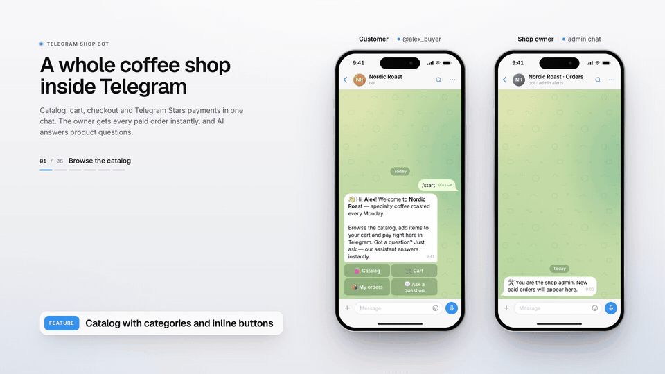
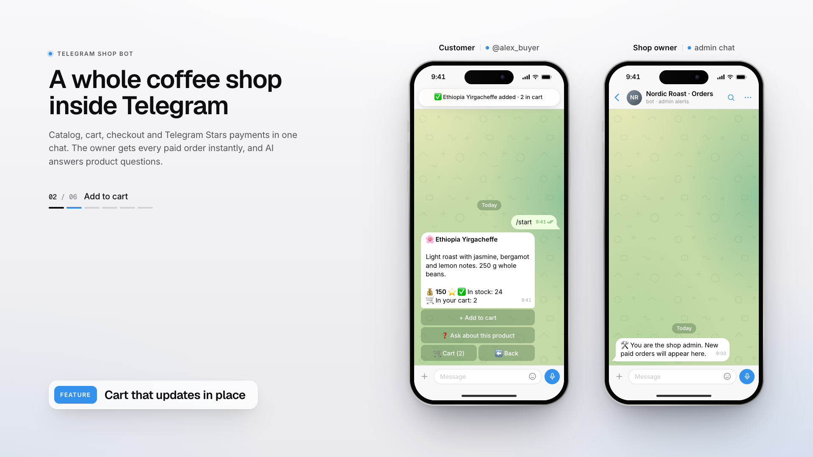
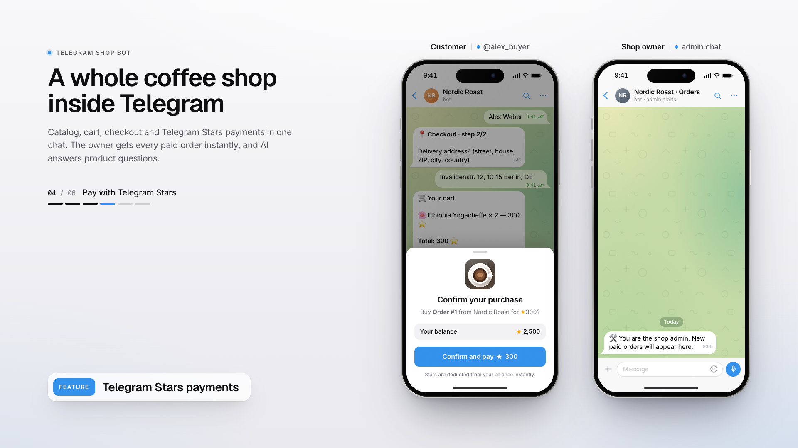
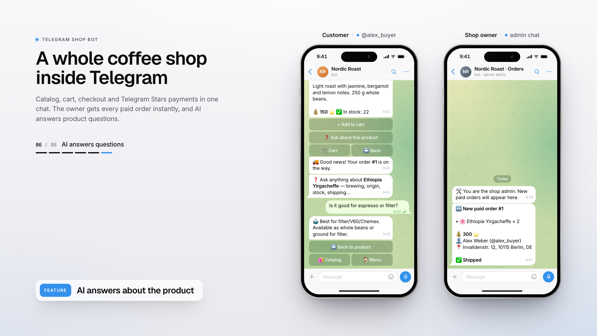
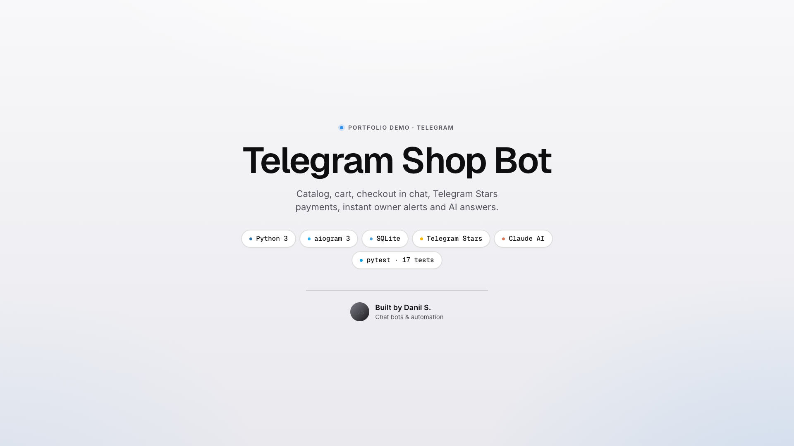

# Telegram Shop Bot — catalog, cart, Telegram Stars payments, AI answers

A ready-to-run online store inside Telegram, built with **Python 3 + aiogram 3 + SQLite**.
Customers browse a catalog, fill a cart, check out in the chat and pay with **Telegram Stars**
(or a card via any Telegram payment provider). The shop owner gets every paid order instantly,
marks it as shipped in one tap, and the customer is notified automatically.
Product questions are answered by an **AI assistant** (Claude) — with a built-in offline fallback.



▶️ **Full demo video (about 48 s, 1080p 60 fps):**

https://github.com/user-attachments/assets/32b2cef1-1917-4018-91d3-481165b9aa16

## Features

**For customers**
- 🛍 Catalog with categories and product cards (price, stock, description)
- 🛒 Cart with ➕/➖, live totals and stock limits
- 📝 Checkout in the chat: name and delivery address with validation
- ⭐ Payment with **Telegram Stars** (`XTR`) — or cards via a provider token (Stripe test mode etc.)
- 📦 "My orders" with status (paid → shipped) and a push message when the parcel ships
- 🤖 "Ask about this product" — AI answers using only the product's facts and shop policies;
  any text outside a flow also goes to the assistant

**For the shop owner (admin panel inside the bot)**
- 🆕 Instant notification for every paid order: items, total, customer, address
- 📦 "Mark as shipped" button → customer gets notified automatically
- `/admin`: customers, paid orders, revenue, orders waiting to ship
- 📣 Broadcast a message to all customers (rate-limited)
- Access restricted to `ADMIN_IDS`

**Reliability**
- Pre-checkout check before Telegram charges: order still valid, not paid twice, amount matches, stock available
- Stock is reduced only after a successful payment
- All user input is HTML-escaped; no secrets in code (`.env`)
- AI never breaks the shop: on any API error or refusal it falls back to template answers

## Screenshots

| Catalog & cart | Telegram Stars payment |
|---|---|
|  |  |
| **Owner alert & AI answer** | **Summary** |
|  |  |

## Tech stack

| Part | Choice |
|---|---|
| Bot framework | aiogram 3 (Routers, FSM, CallbackData factories, middleware) |
| Storage | SQLite (stdlib `sqlite3`) — swap for PostgreSQL in production |
| Payments | Telegram Payments API: Stars (`XTR`) or provider token |
| AI | Anthropic Claude via the official `anthropic` SDK, optional |
| Tests | pytest + pytest-asyncio, Telegram API fully mocked |
| Demo | local web chat emulator (aiohttp) running the same handlers |

## Quick start

```bash
python3 -m venv .venv && source .venv/bin/activate
pip install -r requirements.txt
cp .env.example .env        # put BOT_TOKEN and your Telegram ID in ADMIN_IDS
python -m shop.bot
```

| Variable | Meaning |
|---|---|
| `BOT_TOKEN` | token from @BotFather |
| `ADMIN_IDS` | comma-separated Telegram user IDs that receive orders and can use `/admin` |
| `PAYMENT_MODE` | `stars` (default) or `provider` |
| `PROVIDER_TOKEN` | provider token from BotFather → Payments (use the TEST one for demos) |
| `ANTHROPIC_API_KEY` | optional — enables Claude answers; without it template answers are used |
| `AI_MODEL` | Claude model, default `claude-opus-5-5` |

The demo catalog (a specialty coffee roaster) is seeded on first start — edit `SEED_PRODUCTS`
in `shop/db.py` or the SQLite file to make it your own.

## Try it without a Telegram token

**Tests** — every scenario end-to-end with a mocked Telegram API:

```bash
pip install -r requirements-dev.txt
pytest -q
```

Covered: start → catalog → product card → cart (+/−, stock limit) → checkout validation →
Stars invoice → pre-checkout → payment → admin alert → mark shipped → customer notified,
plus card-provider mode, sold-out and double-payment rejection, AI questions, admin access
control, broadcast, HTML escaping and AI fallback.

**Web emulator** — two phones (customer and owner) in the browser, driven by the real handlers:

```bash
python demo/server.py       # open http://127.0.0.1:8765
```

Re-record the video and screenshots: `pip install playwright && python demo/record.py`
(uses your installed Google Chrome).

## Project layout

```
shop/
  bot.py            entry point, dispatcher factory
  config.py         settings from environment
  db.py             SQLite schema, seed data, queries
  ui.py             texts, keyboards, callback data
  ai.py             assistant interface: Claude or template fallback
  handlers/shop.py  catalog, cart, checkout, payments, questions
  handlers/admin.py admin panel, order alerts, broadcast
  fake_telegram.py  offline Bot API session for tests & emulator
  harness.py        drives the dispatcher: send text, press buttons, pay
demo/               web emulator + video recorder
tests/              pytest scenarios
```

## License

MIT. See [LICENSE](LICENSE).

## Customization ideas

Product photos, promo codes, delivery options and shipping fees, multi-language texts,
Google Sheets / CRM export, PostgreSQL + Redis for scale, webhook deployment on any VPS.
